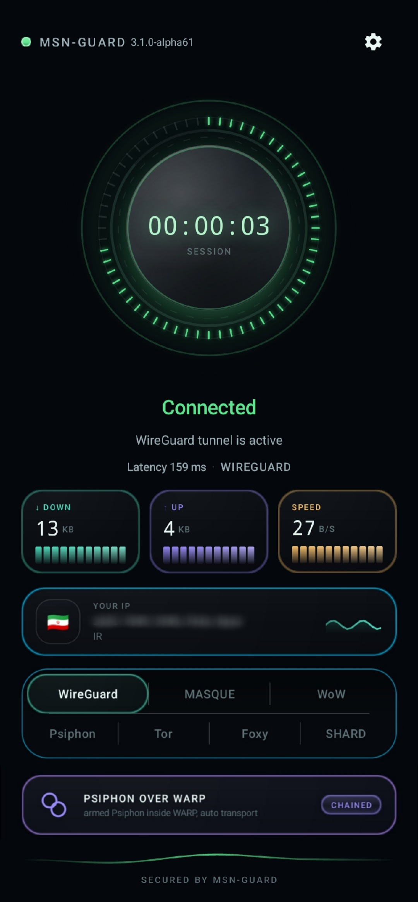

<div dir="rtl" align="center">


# برنامهٔ MSN-GUARD

**تونل سراسری اندروید برای شبکه‌های دشوار و محدود**

[](https://github.com/mbm110/MSN-GUARD/actions)
[](https://github.com/mbm110/MSN-GUARD)
[](LICENSE)
[](#روشهای-اتصال)

**فارسی** · [English](README.en.md)

</div>

---

## نگاهی کوتاه

<p align="center">
  
</p>

برنامهٔ MSN-GUARD برای کسانی ساخته شده که در شبکه‌های دشوار، به یک مسیر اتصال ثابت بسنده نمی‌کنند. برنامه مالک `VpnService` و رابط TUN اندروید است؛ بنابراین ترافیک همهٔ برنامه‌ها می‌تواند بدون تنظیم پراکسی جداگانه از مسیر انتخاب‌شده عبور کند.

رابط برنامه وضعیت‌های مهم را جلوی چشم نگه می‌دارد: مدت نشست، تأخیر، مصرف، سرعت، موقعیت خروجی، روش فعال و سلامت مسیرهای زنجیره‌ای. جزئیات حساس اتصال که باعث دوام مسیر روی یک شبکهٔ مشخص می‌شوند عمداً در این صفحه منتشر نشده‌اند؛ اینجا معماری و قابلیت‌ها را توضیح می‌دهیم، نه دستورالعمل عبور از فیلتر.

## قابلیت‌های اصلی

- **هفت روش اتصال:** WireGuard، MASQUE، WoW، Psiphon، Tor، Foxy و SHARD.
- **چند شکل از انتقال:** مسیرهای مستقیم WARP، WARP تو‌در‌تو، Psiphon روی CDN، Bridgeهای Tor، نشست‌های Foxy و poolهای SHARD.
- **اتصال یک‌کلیکی:** انتخاب اندپوینت، دریافت Identity، انتخاب MTU، بازیابی و بررسی پس از اتصال هماهنگ می‌شوند.
- **بررسی واقعی اتصال:** دست‌دهی به‌تنهایی موفقیت محسوب نمی‌شود؛ تونل باید واقعاً داده جابه‌جا کند.
- **کشف اندپوینت:** حالت‌های اسکن عادی و Ptech، انتخاب خانوادهٔ آدرس، بررسی محدود و اعتبارسنجی مسیر داده.
- **انتخاب خودکار MTU:** هر روش پشتیبانی‌شده می‌تواند پیش از اتصال اندازه‌گیری شود و همان مقدار در TUN و موتور بومی اعمال شود.
- **سه موتور TUN:** موتورهای BadVPN/lwIP، Hev و Zeptun برای مسیرهایی که به پل بستهٔ فضای کاربر نیاز دارند.
- **Identity Vault:** هویت‌های WARP و MASQUE از چند مسیر قابل دریافت‌اند و وضعیت هر روش در تنظیمات نمایش داده می‌شود.
- **پروفایل‌ها:** تنظیمات اتصال، کارایی، مسیریابی، DNS و روش انتقال در پروفایل‌های نام‌گذاری‌شده نگه داشته می‌شوند.
- **یکپارچگی با Tor:** اتصال مستقیم، Bridge، Meek، Snowflake و Tor روی WARP در همان سرویس VPN اندروید مدیریت می‌شوند.
- **یکپارچگی با Psiphon:** انتخاب خودکار مسیر و CDN Fronting به‌صورت مستقل یا داخل WARP قابل استفاده است.
- **عیب‌یابی زنده:** لاگ اتصال، اطلاعات خروجی، شمارنده‌ها، زمان نشست و وضعیت سلامت هنگام اتصال در دسترس‌اند.
- **زبان‌ها:** انگلیسی، فارسی، چینی ساده‌شده و روسی.
- **کنترل‌های حریم خصوصی:** تونل تفکیکی، کنترل DNS، قطع اضطراری و محافظت از سوکت‌های خروجی به جلوگیری از نشت و حلقهٔ مسیریابی کمک می‌کنند.

## روش‌های اتصال

| روش | کاربرد در برنامه |
|---|---|
| **WireGuard** | مسیر مستقیم WARP برای شبکه‌هایی که هنوز UDP در آن‌ها قابل استفاده است. |
| **MASQUE** | WARP روی HTTP/3 همراه با کشف اندپوینت و بررسی مسیر داده. |
| **WoW** | مسیر WARP تو‌در‌تو برای زمانی که مسیر بیرونی می‌تواند مسیر داخلی را حمل کند. |
| **Psiphon** | مسیر مقاوم با انتخاب خودکار راهبرد، CDN Fronting اختیاری و زنجیره شدن با WARP. |
| **Tor** | اتصال مستقیم یا Bridgeهای Tor، همراه با مسیرهای Meek و Snowflake. |
| **Foxy** | انتقال مستقل با حساب کاربری، انتخاب Edge، مدیریت TLS و پل فضای کاربر. |
| **SHARD** | مسیر مبتنی بر pool نود، چرخش اندپوینت، بررسی سلامت و packet front اختصاصی. |

نام‌ها ساده نگه داشته شده‌اند؛ پشت هرکدام چرخهٔ حیات، مدل خرابی، رفتار MTU و روش اعتبارسنجی جداگانه‌ای وجود دارد.

## معماری

```text
برنامه‌های اندروید
        |
        v
VpnService و TUN اندروید
        |
        +--> موتور بستهٔ BadVPN/lwIP، Hev یا Zeptun
        |
        +--> سرپرستی Kotlin و بررسی سلامت انتقال
        |
        +--> هستهٔ Rust برای WARP، MASQUE، WireGuard و کشف مسیر
        |
        +--> اتصال‌های Psiphon / Tor / Foxy / SHARD
        |
        v
مسیر انتخاب‌شده تا شبکهٔ بالادست
```

لایهٔ Kotlin چرخهٔ حیات اندروید، مجوزها، ساخت TUN، تنظیمات، پروفایل‌ها، لاگ‌ها و بازیابی سرویس را مدیریت می‌کند. هستهٔ Rust کارهای بومی خانوادهٔ WARP و شبکه را انجام می‌دهد. بقیهٔ روش‌ها از طریق رابط‌های محلی کنترل‌شده به همان مالک واحد VPN متصل می‌شوند.

## کشف، MTU و اعتبارسنجی

اتصال در MSN-GUARD یک فرایند اندازه‌گیری‌شده است. برنامه بسته به روش انتخابی می‌تواند اندپوینت‌ها را پیدا کند، چند خانوادهٔ آدرس را بررسی کند، بودجهٔ اسکن محدود داشته باشد، MTU مناسب را انتخاب کند و عبور واقعی داده را بسنجد. پاسخ‌دادن یک گیت‌وی به دست‌دهی به‌تنهایی کافی نیست.

منطق fallback خودکار هم همین اصل را دنبال می‌کند: اگر listener زنده باشد اما مسیر داده خالی بماند، آن مسیر تنزل پیدا می‌کند. انتخاب‌های سالم برای شروع اتصال بعدی cache می‌شوند و هنگام تغییر شبکه امکان بررسی تازه وجود دارد.

## Identity و پروفایل‌ها

اعتبارنامه‌های WARP و MASQUE روی دستگاه نگه داشته می‌شوند و به روش مربوط به خودشان وابسته‌اند. دریافت Identity می‌تواند از Relay تنظیم‌شده یا مسیر fallback پشتیبانی‌شده توسط برنامه انجام شود. صفحهٔ تنظیمات وضعیت فایل ذخیره‌شده را می‌خواند تا Identity دریافت‌شده هنگام اتصال از صفحهٔ اصلی در کارت همان روش هم دیده شود.

پروفایل‌های نام‌گذاری‌شده کمک می‌کنند ترکیب‌های مختلفی از روش اتصال، اسکنر، MTU، DNS، زنجیره، خروجی و کارایی بدون تنظیم دوباره ذخیره شوند.

## نصب

نسخه‌های امضاشدهٔ APK از [بخش Releases](https://github.com/mbm110/MSN-GUARD/releases) قابل دریافت‌اند. فایل‌های artifact مربوط به GitHub Actions هم برای آزمایش‌های توسعه در دسترس هستند.

حداقل نسخهٔ موردنیاز Android 8.0 یا API 26 است. اندروید در اولین استفاده مجوز VPN را درخواست می‌کند. بیلدهای جداگانهٔ ARM، نسخهٔ Universal و نسخهٔ مخصوص شبیه‌ساز برای آزمایش در گردش‌کار CI ساخته می‌شوند.

## ساخت

بیلدها با GitHub Actions تولید می‌شوند. هستهٔ بومی، کلاینت اندروید و اجزای انتقال برای هر ABI در گردش‌کار موجود در [`.github/workflows/`](.github/workflows/) ساخته می‌شوند.

مخزن شامل کد Kotlin، Rust و موتورهای بومی پردازش بسته است. اجزای وندورشده مجوزهای خودشان را دارند؛ پیش از بازتوزیع نسخهٔ تغییرکرده، [LICENSE](LICENSE) و اطلاعیه‌های پوشه‌های مربوط را بخوانید.

## امنیت و گزارش مشکل

پارامترهای اتصال، رتبه‌بندی اندپوینت‌ها، زمان‌بندی‌ها و جزئیات مخصوص شبکه عمداً در این صفحه نوشته نشده‌اند. این موارد با تغییر شبکه تغییر می‌کنند و انتشارشان عمر بخش‌های مفید را کوتاه می‌کند.

لطفاً اعتبارنامه، Identity، کلید خصوصی یا ترافیک کاربر را در Issue عمومی قرار ندهید. برای گزارش امنیتی از فرایند خصوصی نوشته‌شده در [SECURITY.md](SECURITY.md) استفاده کنید.

## حمایت از پروژه

اگر MSN-GUARD برایتان مفید است، کمک مالی به ادامهٔ توسعه و آزمایش کمک می‌کند. پیش از ارسال، شبکهٔ درست را انتخاب کنید.

```text
Ethereum Chain
0xA9e165Db72a6f1B3261dfcFb7cc9ADD725Ea2f25

Bitcoin
bc1q4ntxszj643n0ujj3uuncljk8uyprug4swprxlg

Tron Chain
TN58EHrD9AvtVEx4FSka5kitwpgXdXbri9

Solana Chain
3wPEfTm1bCbrU9aqie7xMgAXJK1qXGktRn2yjtjb6LPt
```

## مجوز

برنامهٔ MSN-GUARD با [GNU AGPL-3.0](LICENSE) منتشر می‌شود. اجزای همراه، از جمله quiche، BadVPN، lwIP، Psiphon، Tor و lyrebird، طبق مجوزهای خودشان توزیع می‌شوند.

<div align="center">

**توسعه و نگهداری با [mbm110](https://github.com/mbm110) انجام می‌شود**

</div>
